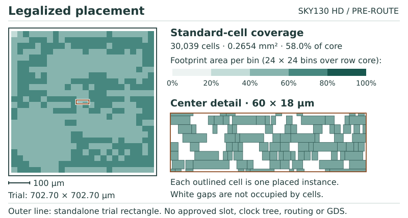

# EEG window commitment core for Sky130

A researcher may need one number: **how many EEG windows contained every sample and fewer than five clipped readings?** This digital core sits after the ADC. For each two-second window it produces a 32-byte commitment: a fingerprint of the ordered samples and missing conversions, made with fresh secret randomness. The recording stays with its owner in the intended system.

**[Read the six-page Chipalooza proposal](proposal/chipalooza-4-private-eeg.pdf)** · [Use the RTL](rtl/INTERFACE.md) · [Reproduce the results](REPRODUCE.md)



**Hardware result:** the clocked RTL matched the independent reference for all 32 output bytes. The trial placement has positive setup and hold margins at **10 MHz in five checked libraries**. At 12 MHz the slow, cold library misses setup by **2.751 ns**. There is no fabricated chip, assigned slot or post-route sign-off. [Physical results](proposal/evidence.md#placement-and-timing) · [Exact margins (CSV)](proposal/timing.csv)

## Try the observer side

The chip does not decide whether a window passes. A separate program proves the count from the committed windows. In the ten-minute synthetic example, a window passes if all 500 slots are present and at most four samples hit a signed rail. From a clone with Rust installed:

```sh
v=examples/verified
cargo run --locked --release --manifest-path proof/Cargo.toml -- \
  verify "$v/vk.bin" "$v/device.pub" "$(cat "$v/study-challenge.txt")" 300 "$v/study.bundle"
# verified: 271 of 300 windows passed QC01
```

The verifier reads two public keys, a recorded challenge and a 77,607-byte proof bundle. It does **not** read the waveform or the list of failed windows. The fixed challenge makes this example repeatable, not live. [What the verifier checks](proof/PROTOCOL.md)

## What was tested

- **On the sample bus:** a missing conversion has a different encoding from a present sample of zero. A reset or capture overrun aborts the window. The [byte-wide bench procedure](proposal/measurement.md) checks the published root, not just a status light.
- **On recorded EEG:** replaying four seconds of public PhysioNet data with one deliberately missing conversion gave **1 of 2 windows passing**. The RTL produced exactly the two roots in the signed test manifest. [Waveform and results](proposal/evidence.md)
- **On the verifier:** changing the claimed total, omitting a window or using a different challenge invalidated the result. The claim is about **the captured digital sequence**, not who produced it. A real recorder needs a trusted ADC path, timer, randomness and signer. The desktop proof is not an on-chip prover.

## Reuse or review

| Looking for | Start here |
|---|---|
| The reusable block, not the shuttle fixture | [`eeg_capture.sv`](rtl/eeg_capture.sv) and the [signal contract](rtl/INTERFACE.md) |
| Pad request, electrical targets and measurement plan | [Proposal](proposal/proposal.md#io-and-test-limits) and [bench procedure](proposal/measurement.md) |
| Open tools and independent test vectors | [Reproduction guide](REPRODUCE.md) |
| Contest fit and outstanding filing items | [Rules review and precedents](proposal/FILING.md) |

Original design and software: [Apache-2.0](LICENSE). Recorded test data: [PhysioNet attribution and separate license](examples/oz/attribution.json). Bench signals only; no connection to a person.
