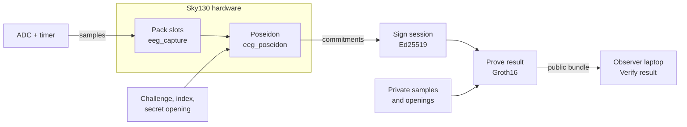

# Private EEG verification

An EEG recording can reveal much more than a participant agrees to share. This project is a chip module and companion software for sharing a result instead. The owner can give a researcher a zero-knowledge proof about the recording; the researcher can check the result on a laptop without receiving the brainwave samples.

The [Sky130 hardware design](rtl/eeg_capture.sv) sits on the recorder's digital sample bus. For a two-second window, it combines the ordered samples with a fresh secret random value and produces a 32-byte **commitment**. The commitment pins down which readings the owner's software must use when it makes the proof. In the demo, a lab verifies how many windows met a capture-quality rule without learning the individual readings.

[Read the chip proposal (PDF)](proposal/chipalooza-4-private-eeg.pdf) or [run the verifier](#try-the-verifier).

## System architecture



The chip commits to what it sees on the digital sample bus, including a marker when a conversion is missing. It does not keep the waveform for the prover. In the prototype, signing and proving run in software. The signature identifies the recorder that vouched for the commitments; neither it nor the proof can tell whether the samples actually came from a person's electrodes. A live recorder would also need a trusted ADC, clock, random source and signing key.

## Try the verifier

The implemented proof answers one question: how many two-second windows contained all 500 scheduled readings and at most four readings at either digital limit? The threshold is the example study's rule, called `QC01`, not a medical measure. A different question would need a different proof circuit.

With Rust installed, run this on the observer's laptop. It uses a ten-minute synthetic session:

```sh
v=examples/verified
cargo run --locked --release --manifest-path proof/Cargo.toml -- \
  verify "$v/vk.bin" "$v/device.pub" "$(cat "$v/study-challenge.txt")" 300 "$v/study.bundle"
# verified: 271 of 300 windows passed QC01
```

The verifier checks the recorder's signature and the proofs for all 300 windows. It reports the total, not which windows failed. It needs no sample file, private opening or signing key. The example reuses a recorded challenge; for a live session the observer issues a fresh one. See the [proof format and trust assumptions](proof/PROTOCOL.md).

There is also a [four-second replay of a public EEG recording](proposal/evidence.md). After one deliberately omitted conversion, one of its two windows passed. Both commitments from the simulated RTL matched the ones used by the software.

## Hardware status

The design has been simulated, synthesized and placed, but not fabricated. In five pre-route timing estimates, the placed design met 10 MHz; at the 12 MHz target, the slow, cold case missed setup by 2.751 ns. Finalizing one window takes time before the next can start. A recorder that must not miss a sample between windows needs a private buffer outside this module.

- [Hardware interface](rtl/INTERFACE.md) and [silicon measurement plan](proposal/measurement.md)
- [Build and reproduce the results](REPRODUCE.md), including the [timing results](proposal/timing.csv) and [release audit](proposal/AUDIT.md)

The design and software are [Apache-2.0](LICENSE). The [public EEG excerpt](examples/oz/attribution.json) has separate attribution and licensing.
