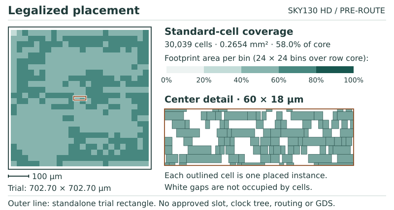
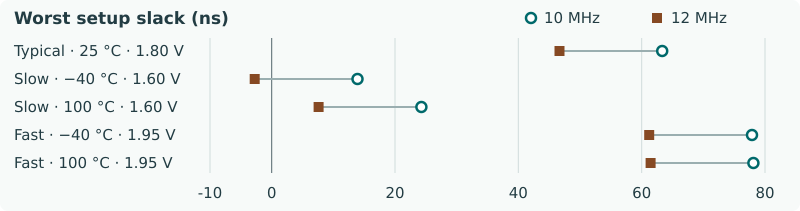

# What the tests showed

## A missing conversion is not a flat signal

The input is four seconds from the [PhysioNet EEG Motor Movement/Imagery Dataset](https://doi.org/10.13026/C28G6P), S001 R02, channel Oz. The test holds the 160 Hz input on a 250 Hz schedule and marks slot 610 missing. Both 500-slot roots from the simulated RTL matched the software recorder’s signed manifest bit for bit. The observer verified **1 of 2 windows passed** without opening either one. This is replay of an attributed recording, not live acquisition.

**Hardware bench.** The software oracle reproduced three frozen answers covering both signed rails and a missing slot. The byte wrapper matched all 32 bytes of each root, including the missing slot with nonzero data on the ignored bus. Reset, overrun, malformed commands and a noncanonical opening produced no valid root. With one strobed command every 5,500 clocks (22,000 per slot), the last tick to `root_valid` took **212,993 clocks**: 38.73 ms at 5.5 MHz. Slow polling cannot measure that edge precisely.

**Longer session.** In a separate ten-minute synthetic test, 15 windows had five rail samples and 14 others had a missing conversion. The laptop verified **271 of 300**. The bundle was 77,607 bytes, including one 192-byte Groth16 proof per window. Proving took 189.11 s and verification 0.50 s on an arm64 workstation with four Rayon workers; prover peak RSS was 385,990,656 bytes. These are host measurements, not on-chip benchmarks.

The verifier rejected a different challenge, device key, policy, root or total, and rejected omitted or swapped proofs. These are development keys. Archived receipts verify under their original challenge; live observers must issue and retire fresh challenges. The public EEG and synthetic fixtures let readers recompute individual outcomes. A receipt authenticates the recorder's signed roots, not the provenance of a named dataset.

## Placement and timing

The first, unbuffered map missed 12 MHz setup by 377.294 ns. Buffering the high-fanout controls and resizing at slow/cold brought the wrapper and core to **0.2654 mm² of cells**. The row area is **0.4574 mm²**; the outer trial rectangle is **0.4938 mm²**. The latter is the relevant starting point for a slot discussion, not the sum of the cell areas.

At **10 MHz**, all five placed-library estimates have positive setup and hold slack. At **12 MHz**, the **−40 °C slow library misses setup by 2.751 ns**. That makes 12 MHz a design target, not a corner-qualified rating. The 1.60 V libraries are guardband cases for the 1.62 V target; no 110 °C library was tested.

These estimates use an ideal clock, 3 ns external I/O delays, 0.02 pF loads and placement-estimated wire RC. There is no clock tree, routing, extracted timing, DRC/LVS or silicon power measurement. A continuous recorder also needs buffering across finalization and rearming. Neither the trial placement nor the 300-window host run establishes gapless capture.
