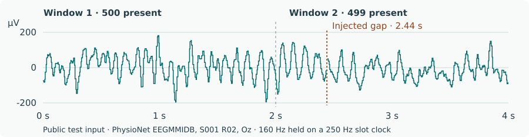

## A four-second EEG replay

We replayed S001 R02 from the [PhysioNet EEG Motor Movement/Imagery Dataset](https://doi.org/10.13026/C28G6P), holding each 160 Hz reading on the 250 Hz schedule and marking slot 610 missing. Both simulated hardware roots matched the software recorder’s signed roots bit for bit. Using those roots and the proof, the laptop verified that **1 of 2 windows passed QC01**. The waveform was not a verifier input. It is public here so anyone can repeat the experiment.

### Does the chip commit to the right samples?

We fed three known windows through the byte-wide test port and compared every output byte with an independent integer implementation. The inputs were chosen to distinguish a quality decision from the commitment itself. The core always returns a root for a complete sequence of scheduled ticks, even when the quality rule fails.

| Window supplied to the core | Quality decision in software | Hardware result |
|---|---|---|
| Index 0, four readings at the negative rail | Pass | All 32 bytes matched |
| Index 1, five readings at the positive rail | Fail: too many rail readings | All 32 bytes matched |
| Index 0 as above, but slot 7 is missing | Fail: incomplete window | All 32 bytes matched; different root from the first window |

The missing-slot root matched even with nonzero ignored bus data. Reset, overrun, malformed commands and a noncanonical opening produced no valid root. At 5,500 clocks/command and 22,000 clocks/slot, the simulation took 212,993 clocks from the last tick to `root_valid` (38.73 ms at 5.5 MHz).

### Ten minutes of synthetic input

Fifteen windows had five rail samples; 14 others had a missing conversion. The laptop verified **271 of 300**. The 77,607-byte bundle included one 192-byte Groth16 proof per window. On an arm64 workstation with four Rayon workers, proving took 189.11 s (peak RSS 385,990,656 bytes); verification took 0.50 s.

The verifier rejected changed challenges, device keys, policies, roots and totals, and omitted or swapped proofs. The demo uses development keys. Archived proofs still verify for their original challenge; a live observer must issue and retire fresh challenges. Neither the proof nor the signature establishes the provenance of a public fixture.

## Physical design and timing

Before placement, the initial unbuffered netlist missed 12 MHz setup by 377.294 ns. Buffering high-fanout controls and resizing at the slow, cold corner brought the wrapper and core to 0.2654 mm² of standard cells. The placement rows cover 0.4574 mm²; the outer rectangle covers 0.4938 mm². It is the outer rectangle, not the sum of cell areas, that must fit a shuttle slot.

All five libraries met setup and hold at 10 MHz; the smallest setup margin was +13.916 ns. At the 12 MHz target, the −40 °C slow library missed setup by 2.751 ns. The 1.60 V libraries are guardband cases for the 1.62 V target. No 110 °C library was tested.

The estimates assume an ideal clock, 3 ns external I/O delays, 0.02 pF loads and wire resistance and capacitance estimated from placement. There is no clock tree, routed or extracted timing, DRC/LVS result or silicon power measurement. These estimates and the host replay do not establish gapless capture.
