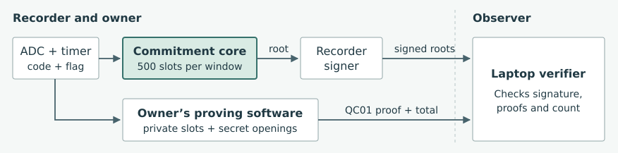

# Private EEG window commitment IP

**Chipalooza Challenge #4 · Chip Foundry Sky130 · written proposal**

**Type of block:** reusable 1.8 V digital acquisition-side commitment engine. **Use case:** a research participant keeps the recording; an observer checks how many scheduled EEG windows met a specified data-quality rule. The host demonstration verified **271 of 300** windows on a ten-minute synthetic study fixture. It did not disclose any samples or per-window flags. This is not a participant or silicon result.

**What is proposed for silicon.** One core binds an ordered two-second, one-channel sample window, including missing conversions, to a 32-byte public digest (the *root*). Private fresh randomness makes it infeasible to guess a predictable waveform simply by hashing candidates. Altering a sample, missing flag, index or session changes what the recorder has committed to. The root is not encryption, a digital signature, or proof of physical origin.

**Why a custom block?** Put the commitment at the acquisition boundary, before a laptop can select windows or replace samples. The same fixed digital interface can be driven by an integrated ADC in a future SoC or by reproducible digital vectors on the shuttle. A separate proof circuit lets a verifier check the published rule against these roots without opening any window.

**Non-claims.** No amplifier, ADC, entropy source, signing key store, TEE or ZK prover is included in the slot. The companion proof runs on a computer on nonsecret test material. No human connection, diagnosis, medical inference, clinical validation or production security claim. The limited one-channel IP does not replace an eight-channel integrated recorder or decoder.

## Functional contract

**One input is a scheduled slot, not merely a received packet.** A trusted timer must issue exactly 500 ticks for a window; the ADC supplies a signed-24 representation and a present flag per tick. A missing conversion contributes an explicit zero slot. It cannot silently shorten the window. The chip cannot detect a stopped or falsified external clock; a production recorder must enforce the cadence and reject incomplete scheduled sessions.

1. Start with a 128-bit verifier challenge, a 16-bit zero-based index and a fresh secret field element. Never reuse openings between windows. For fixed public tests only, openings may be known. Start and data commands are separate clock events.
2. For a present reading encode `2^24 + unsigned(raw24)`; encode zero for missing, ignoring bus data. Pack ten successive 25-bit codes into one field word, earliest in the least significant bits. All 250-bit packed words fit the field without reduction. Exactly 50 words per window.
3. The field is the BLS12-381 scalar field. Initialize a three-element state with `0x45454701 + index × 2^32`, challenge interpreted as a little-endian unsigned integer, and the blind. Permute once. For each packed word add it to state element zero in the field and permute again. Emit only final element zero. Use Poseidon with eight full rounds, 57 partial rounds, exponent five and versioned constants. The input length and domain are fixed; this is not a general-purpose variable-length hash API.
4. Consumers use the valid indication, not stale data. A synchronous reset aborts the window; the chip must not issue a root for an interrupted window. An input overrun is a failed window, not a license to drop or invent a sample. Provision sufficiently fast clocking and respect start/readout boundaries.

### What the verifier checks

A window passes iff **all 500 slots are present and fewer than five present samples are at either signed rail**, −8,388,608 or +8,388,607. Four clipped samples pass; five fail. This is a digital QA rule, not evidence of good electrode contact or usable physiology. The two-second windows for this count are distinct, not four overlapping command updates per second.

The complete ordered list of roots is authenticated by a recorder signature outside the IP. The verifier must pin the recorder identity, approved proof-verification key, rule, fresh challenge and expected number of windows independently. A private proof for each root checks the raw slots, missing/rail rule and increment of a hidden running count. Adjacent proofs must bind the same intermediate count commitment. Only the starting zero and reported final total are opened. Omitting an inconvenient window must fail verification. Acceptance means **the specified rule holds over the committed sequence**; it does not prove liveness of the electrodes, wall-clock continuity or who supplied the signal.

## I/O, slot resources and absolute limits

| Boundary | Inputs | Outputs |
|-----------|---------------------------|----------------------|
| Reusable IP | Clock, synchronous active-high reset, start; nonce[127:0], index[15:0], blind[254:0]; slot tick, sample present, raw[23:0]. | Busy, ready, root-valid, root[254:0] (32 bytes padded). No raw, pass flag or blind readback. |
| Test wrapper | Clock, reset, strobe, op[2:0], data[7:0]: **14 digital inputs**. | Data[7:0], busy, ready, root-valid: **11 digital outputs**. |
| Harness | 1.8 V core and ground. No reference current, analog line, special impedance or dedicated pad requested. | Standard digital level translation. Clock routing, control rate and slot allocation require approval. |

**Test protocol.** Load the little-endian index, challenge and blind; start; load three bytes and issue a present tick, or issue a missing tick. Read root bytes by index. The fixture controls expose test inputs and openings: never connect this loader, debug or scan to an untrusted observer in a product.

| Target / condition | Minimum | Nominal | Maximum / limit |
|--------------------|----------:|----------:|-----------------:|
| Qualified digital supply target (V) | 1.62 | 1.80 | 1.98 |
| Qualified operating temperature target (°C) | −40 | 25 | +110 |
| Application sample slots/s in window | 250 | 250 | 250 (fixed profile) |
| Scheduled slots/window; duration | 500; 2 s | 500; 2 s | 500; 2 s |
| Clock for sustained in-window capture | 5.325 MHz service floor | 12 MHz target | No higher characterized rating claimed |
| Encoded input, present | −8,388,608 | signal dependent | +8,388,607 |
| Session count reported, for N authenticated windows | 0 | input dependent | N; demo tool N ≤ 65,535 |
| Normal root output / complete window | 32 B | 32 B | 32 B |
| Standalone footprint / active power budgets | — | 12 MHz QA workload | ≤0.55 mm² trial footprint; ≤20 mW average active power (targets) |

**Absolute test limits:** only drive a powered core, between VSS and actual VDD. No direct 3.3 V signals. Do not exceed 1.98 V or the stated temperature range. These are test limits, not foundry stress or ESD ratings; confirm package pin, current and sequencing ratings with the harness owner before power-up. No silicon ratings, slot assignment or power measurement are claimed.
